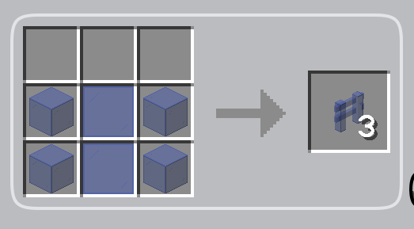
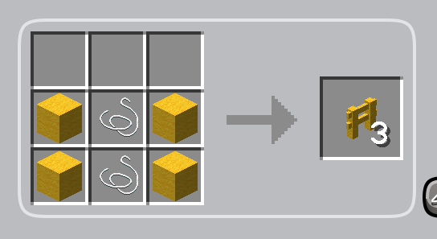

# MoreFences

> 你是否还在为 Minecraft 里没有对应颜色的栅栏/栅栏门而被迫使用其它不好看的栅栏?
> 
> 你是否还在为了翻遍各大网站而找不到一个独立的栅栏模组而烦恼?

**那恭喜你, 你发现了本模组!**

## ToC

- [MoreFences](#morefences)
  - [ToC](#toc)
  - [I. 栅栏/栅栏门](#i-栅栏栅栏门)
  - [II. 合成配方](#ii-合成配方)
    - [2.1 玻璃系](#21-玻璃系)
    - [2.2 羊毛系](#22-羊毛系)
  - [III. 连通性限制](#iii-连通性限制)
  - [IV. Public API](#iv-public-api)
  - [V. 材质](#v-材质)
  - [VI. License](#vi-license)

---

## I. 栅栏/栅栏门

如模组名所描述的那样, 本模组目前为游戏添加了不同玻璃/羊毛变体对应的栅栏/栅栏门, 总`68*Block + 68*Item`, 此处不赘述.

它们会继承基底方块的属性(硬度、音效、是否会被点燃等), 与原版栅栏一样可以含水、可以系上拴绳;

栅栏门保留了原版行为, 可以被红石控制、被爆炸打开.

另外, 羊毛系的栅栏与栅栏门可以作为熔炉燃料, 而玻璃系则不可以(这很合理).

---

## II. 合成配方

配方结构与原版木栅栏/栅栏门形状相似, 只是存在部分细微差别(见图)

### 2.1 玻璃系



其余颜色同理.

### 2.2 羊毛系



其余颜色同理.

---

## III. 连通性限制

玻璃系与羊毛系是不能连在一起的, 因为它们分属不同的组别; 同样的, 此二者也不能和原版的木栅栏/下界砖栅栏连接.

只有同一组别内的可以相互连接, 与颜色无关.

当前的组别有 `glass` 与 `wool`. 如果需要调整, 可以用数据包改这些 tag:

|tag|描述|
|---|---|
|`morefences:fences` / `morefences:fence_gates`|本模组的全部栅栏/栅栏门|
|`morefences:<组名>_fences` / `morefences:<组名>_fence_gates`|某个组的栅栏/栅栏门, 把一个外部方块加进某个组的 tag, 模组就会把它当作该组的成员|

---

## IV. Public API

以下是目前公开的, 可能对模组开发者有用的 API:

|名称|路径|说明|
|---|---|---|
|`MoreFencesApi`|`top.starwindv.morefences.api.MoreFencesApi`|模组作者的入口|
|`addGlass(Block[, Item[, Identifier]])`|同上|把一个玻璃方块加入 `glass` 组|
|`addBlock(FenceGroup, Block[, Item[, Identifier]])`|同上|把一个方块加入指定组|
|`registerGroup(String, SoundType, Function<Block, Item>, boolean)`|同上|注册新的材质组, 返回的组可用于 `addBlock`|
|`getEntry(Block)` / `hasFenceFor(Block)`|同上|查询某个方块是否已经生成过栅栏|
|`FenceGroup`|`top.starwindv.morefences.FenceGroup`|材质组, 内置 `GLASS` 与 `WOOL`; `fuel(int, int)` 与 `fuelFromMaterials(IntUnaryOperator, IntUnaryOperator)` 设置燃烧时间, 默认不可燃|
|`MoreFencesContent`|`top.starwindv.morefences.MoreFencesContent`|注册表与注册流程的实现, 一般不需要直接使用|

用法(所有调用都要在游戏启动阶段, 即 `main` entrypoint 中完成):

```java
public class MyMod implements ModInitializer {
    @Override
    public void onInitialize() {
        // 加入现成的玻璃组
        MoreFencesApi.addGlass(MyModBlocks.CRYSTAL_GLASS);

        // 或者注册一个新组: 它只会与自己组内的栅栏相连, 并且使用自己的音效与配方材料
        FenceGroup crystal = MoreFencesApi.registerGroup("crystal", SoundType.AMETHYST, base -> MyModItems.CRYSTAL_ROD, true);
        MoreFencesApi.addBlock(crystal, MyModBlocks.CRYSTAL_BLOCK);
    }
}
```

Hint:

- 基底方块必须有物品形式(`BlockItem`), 因为它就是配方里的 `W`;
- 贴图默认取基底方块的 `<命名空间>:block/<路径>`, 贴图不对时可以用 `Identifier` 参数显式指定;
- 模型、配方、战利品表与 tag 都是编译期生成的, 所以要得到完整结果(可用的贴图、配方与 tag), 构建时也必须装着那个方块所属的模组; 只在运行时注册的话, 只会有方块与物品本身.

---

## V. 材质

本模组使用动态方式加载贴图与模型, 因此理论上可以自动兼容原材料所对应的方块贴图, 以及材质包提供的对应模型.

- 模型直接复用原版的栅栏/栅栏门模板, 把 `texture` 槽填成基底方块的 sprite, 贴图是对原方块贴图的引用;
- 贴图 id 默认为基底方块的 `<命名空间>:block/<路径>`, 例如 `minecraft:block/red_stained_glass`;
- 是否使用半透明渲染由材质组决定, 玻璃组会带上 `force_translucent`(与原版玻璃模型一致), 羊毛组则保持不透明;
- 材质包替换原版玻璃/羊毛贴图时, 模组提供的栅栏会自动变化; 想要完全自定义外观, 覆盖 `assets/morefences/models/block/` 下对应的模型文件即可;
- 通过 API 注册方块时, 可以用 `Identifier` 参数指定与默认规则不同的 sprite.

---

## VI. License

本项目以[Apache-2.0](./LICENSE)协议开源.
